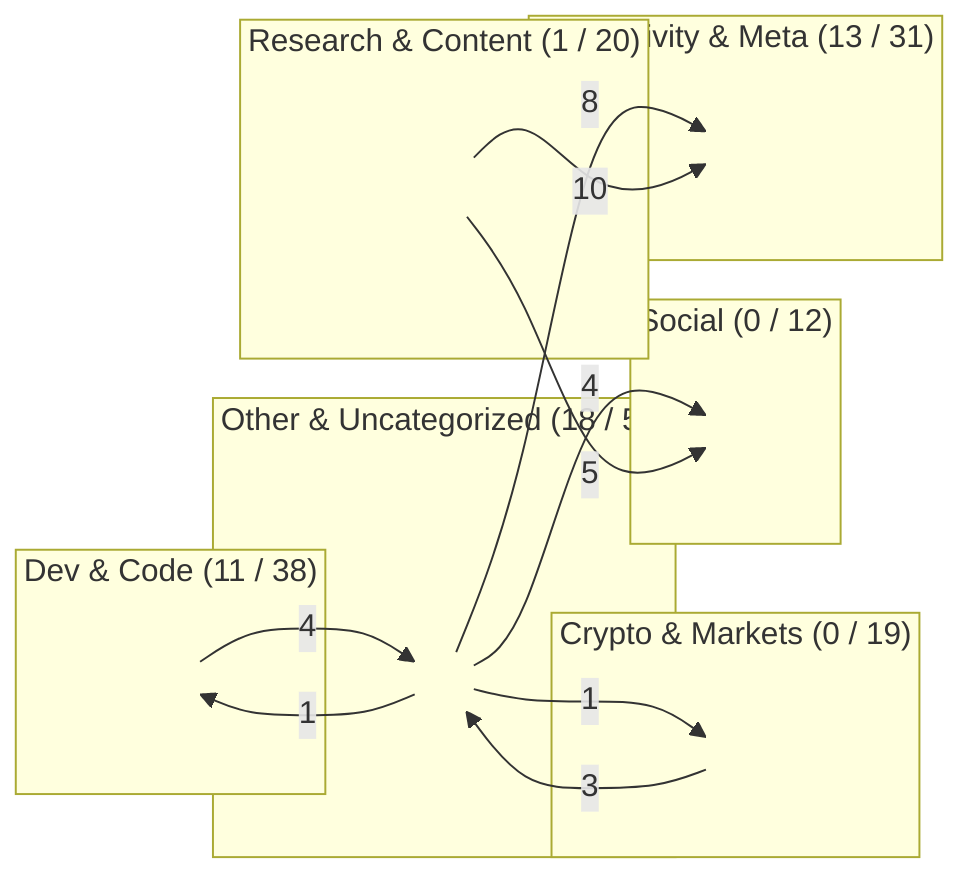
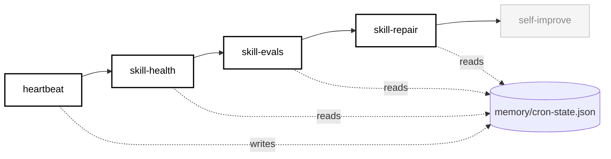
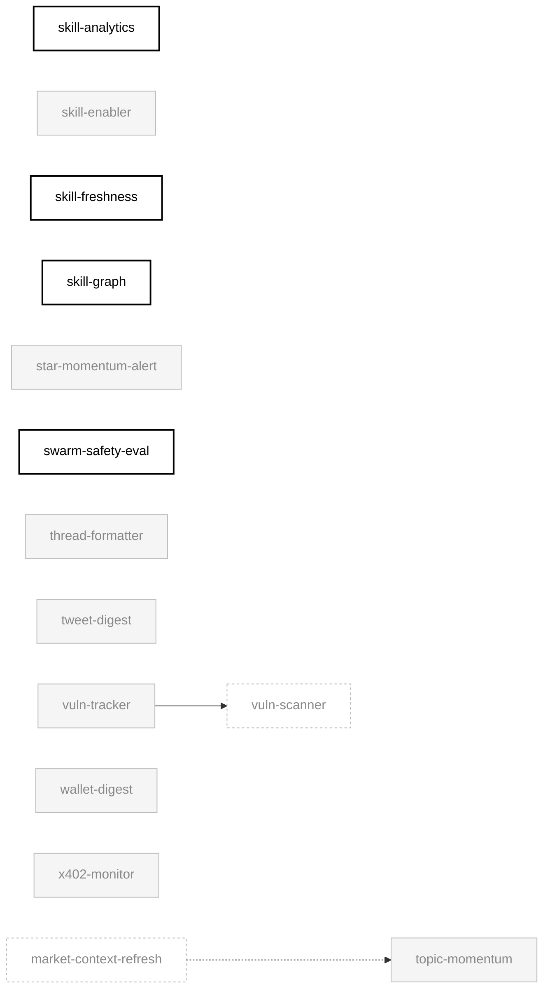

# Skill Dependency Graph

> Auto-generated by `skill-graph` on 2026-11-08. Mode: `SKILL_GRAPH_NEW`.

**Verdict:** SKILL_GRAPH_NEW — 172 skills mapped across 6 categories, 43 enabled

## Overview

Category boxes show **enabled / total** skill counts. Cross-category edges carry their count.

_Every skill also writes `memory/cron-state.json`, which is read by `heartbeat`, `skill-health`, `skill-repair`, and `skill-evals`. Collapsed here to keep the map readable — see Self-healing loop below._

## Self-healing loop

Reactive trigger: `skill-repair` fires on `consecutive_failures >= 3` for any skill (`*`); `planner` fires on `consecutive_failures >= 2` for any skill (`*`).

## Research & Content

1 enabled · 20 total.

```mermaid
flowchart LR
    article[article]
    channel-recap[channel-recap]
    competitor-launch-radar[competitor-launch-radar]
    deep-research[deep-research]
    digest[digest]
    fetch-tweets[fetch-tweets]
    hacker-news-digest[hacker-news-digest]
    huggingface-trending[huggingface-trending]
    last30[last30]
    list-digest[list-digest]
    paper-digest[paper-digest]
    paper-pick[paper-pick]
    reddit-digest[reddit-digest]
    research-brief[research-brief]
    rss-digest[rss-digest]
    security-digest[security-digest]
    surplus-pulse[surplus-pulse]
    technical-explainer[technical-explainer]
    telegram-digest[telegram-digest]
    vibecoding-digest[vibecoding-digest]
    rss-feed_ext[rss-feed]:::external
    syndicate-article_ext[syndicate-article]:::external
    update-gallery_ext[update-gallery]:::external
    competitor-launch-radar -.-> syndicate-article_ext
    competitor-launch-radar -.-> rss-feed_ext
    competitor-launch-radar -.-> update-gallery_ext
    deep-research -.-> syndicate-article_ext
    deep-research -.-> rss-feed_ext
    deep-research -.-> update-gallery_ext
    last30 -.-> syndicate-article_ext
    last30 -.-> rss-feed_ext
    last30 -.-> update-gallery_ext
    paper-digest -.-> syndicate-article_ext
    paper-digest -.-> rss-feed_ext
    paper-digest -.-> update-gallery_ext
    research-brief -.-> syndicate-article_ext
    research-brief -.-> rss-feed_ext
    research-brief -.-> update-gallery_ext
    class article disabled
    class channel-recap disabled
    class competitor-launch-radar disabled
    class deep-research disabled
    class digest disabled
    class fetch-tweets disabled
    class hacker-news-digest disabled
    class huggingface-trending disabled
    class last30 disabled
    class list-digest disabled
    class paper-digest disabled
    class paper-pick disabled
    class reddit-digest disabled
    class research-brief disabled
    class rss-digest disabled
    class security-digest disabled
    class surplus-pulse enabled
    class technical-explainer disabled
    class telegram-digest disabled
    class vibecoding-digest disabled
    classDef enabled fill:#fff,stroke:#000,stroke-width:2px,color:#000
    classDef disabled fill:#f5f5f5,stroke:#bbb,color:#888
    classDef external fill:none,stroke:#bbb,stroke-dasharray:3 3,color:#888
    click article "../skills/article/SKILL.md"
    click channel-recap "../skills/channel-recap/SKILL.md"
    click competitor-launch-radar "../skills/competitor-launch-radar/SKILL.md"
    click deep-research "../skills/deep-research/SKILL.md"
    click digest "../skills/digest/SKILL.md"
    click fetch-tweets "../skills/fetch-tweets/SKILL.md"
    click hacker-news-digest "../skills/hacker-news-digest/SKILL.md"
    click huggingface-trending "../skills/huggingface-trending/SKILL.md"
    click last30 "../skills/last30/SKILL.md"
    click list-digest "../skills/list-digest/SKILL.md"
    click paper-digest "../skills/paper-digest/SKILL.md"
    click paper-pick "../skills/paper-pick/SKILL.md"
    click reddit-digest "../skills/reddit-digest/SKILL.md"
    click research-brief "../skills/research-brief/SKILL.md"
    click rss-digest "../skills/rss-digest/SKILL.md"
    click security-digest "../skills/security-digest/SKILL.md"
    click surplus-pulse "../skills/surplus-pulse/SKILL.md"
    click technical-explainer "../skills/technical-explainer/SKILL.md"
    click telegram-digest "../skills/telegram-digest/SKILL.md"
    click vibecoding-digest "../skills/vibecoding-digest/SKILL.md"
```

## Dev & Code

11 enabled · 38 total.

```mermaid
flowchart LR
    auto-merge[auto-merge]
    auto-workflow[auto-workflow]
    autoresearch[autoresearch]
    changelog[changelog]
    code-health[code-health]
    compute-futures-eda[compute-futures-eda]
    compute-macro-correlate[compute-macro-correlate]
    create-skill[create-skill]
    deploy-prototype[deploy-prototype]
    external-feature[external-feature]
    fleet-control[fleet-control]
    fork-cohort[fork-cohort]
    fork-first-run-alert[fork-first-run-alert]
    fork-fleet[fork-fleet]
    fork-skill-gap[fork-skill-gap]
    frontier-eval[frontier-eval]
    github-issues[github-issues]
    github-monitor[github-monitor]
    github-releases[github-releases]
    github-trending[github-trending]
    issue-triage[issue-triage]
    pr-review[pr-review]
    pr-triage[pr-triage]
    programmatic-eda[programmatic-eda]
    project-lens[project-lens]
    push-recap[push-recap]
    repo-actions[repo-actions]
    repo-article[repo-article]
    repo-pulse[repo-pulse]
    repo-scanner[repo-scanner]
    search-skill[search-skill]
    skill-security-scan[skill-security-scan]
    smithery-manifest[smithery-manifest]
    spawn-instance[spawn-instance]
    star-milestone[star-milestone]
    vercel-projects[vercel-projects]
    vuln-scanner[vuln-scanner]
    workflow-security-audit[workflow-security-audit]
    external-feature --> repo-scanner
    vuln-scanner --> github-trending
    fork-cohort -..-> fork-first-run-alert
    fork-cohort -..-> fork-skill-gap
    repo-scanner -..-> external-feature
    repo-scanner -..-> repo-actions
    repo-scanner -..-> vercel-projects
    vercel-projects -..-> external-feature
    vercel-projects -..-> repo-actions
    vercel-projects -..-> repo-scanner
    contributor-spotlight_ext[contributor-spotlight]:::external
    fleet-state_ext[fleet-state]:::external
    idea-pipeline_ext[idea-pipeline]:::external
    vuln-tracker_ext[vuln-tracker]:::external
    vuln-tracker_ext --> vuln-scanner
    deploy-prototype -..-> idea-pipeline_ext
    fork-cohort -..-> contributor-spotlight_ext
    fork-cohort -..-> fleet-state_ext
    vercel-projects -..-> idea-pipeline_ext
    class auto-merge disabled
    class auto-workflow disabled
    class autoresearch disabled
    class changelog enabled
    class code-health enabled
    class compute-futures-eda enabled
    class compute-macro-correlate enabled
    class create-skill disabled
    class deploy-prototype disabled
    class external-feature disabled
    class fleet-control enabled
    class fork-cohort disabled
    class fork-first-run-alert disabled
    class fork-fleet disabled
    class fork-skill-gap disabled
    class frontier-eval disabled
    class github-issues disabled
    class github-monitor enabled
    class github-releases disabled
    class github-trending disabled
    class issue-triage enabled
    class pr-review enabled
    class pr-triage enabled
    class programmatic-eda disabled
    class project-lens disabled
    class push-recap disabled
    class repo-actions disabled
    class repo-article disabled
    class repo-pulse disabled
    class repo-scanner disabled
    class search-skill disabled
    class skill-security-scan disabled
    class smithery-manifest disabled
    class spawn-instance disabled
    class star-milestone disabled
    class vercel-projects disabled
    class vuln-scanner enabled
    class workflow-security-audit enabled
    classDef enabled fill:#fff,stroke:#000,stroke-width:2px,color:#000
    classDef disabled fill:#f5f5f5,stroke:#bbb,color:#888
    classDef external fill:none,stroke:#bbb,stroke-dasharray:3 3,color:#888
    click auto-merge "../skills/auto-merge/SKILL.md"
    click auto-workflow "../skills/auto-workflow/SKILL.md"
    click autoresearch "../skills/autoresearch/SKILL.md"
    click changelog "../skills/changelog/SKILL.md"
    click code-health "../skills/code-health/SKILL.md"
    click compute-futures-eda "../skills/compute-futures-eda/SKILL.md"
    click compute-macro-correlate "../skills/compute-macro-correlate/SKILL.md"
    click create-skill "../skills/create-skill/SKILL.md"
    click deploy-prototype "../skills/deploy-prototype/SKILL.md"
    click external-feature "../skills/external-feature/SKILL.md"
    click fleet-control "../skills/fleet-control/SKILL.md"
    click fork-cohort "../skills/fork-cohort/SKILL.md"
    click fork-first-run-alert "../skills/fork-first-run-alert/SKILL.md"
    click fork-fleet "../skills/fork-fleet/SKILL.md"
    click fork-skill-gap "../skills/fork-skill-gap/SKILL.md"
    click frontier-eval "../skills/frontier-eval/SKILL.md"
    click github-issues "../skills/github-issues/SKILL.md"
    click github-monitor "../skills/github-monitor/SKILL.md"
    click github-releases "../skills/github-releases/SKILL.md"
    click github-trending "../skills/github-trending/SKILL.md"
    click issue-triage "../skills/issue-triage/SKILL.md"
    click pr-review "../skills/pr-review/SKILL.md"
    click pr-triage "../skills/pr-triage/SKILL.md"
    click programmatic-eda "../skills/programmatic-eda/SKILL.md"
    click project-lens "../skills/project-lens/SKILL.md"
    click push-recap "../skills/push-recap/SKILL.md"
    click repo-actions "../skills/repo-actions/SKILL.md"
    click repo-article "../skills/repo-article/SKILL.md"
    click repo-pulse "../skills/repo-pulse/SKILL.md"
    click repo-scanner "../skills/repo-scanner/SKILL.md"
    click search-skill "../skills/search-skill/SKILL.md"
    click skill-security-scan "../skills/skill-security-scan/SKILL.md"
    click smithery-manifest "../skills/smithery-manifest/SKILL.md"
    click spawn-instance "../skills/spawn-instance/SKILL.md"
    click star-milestone "../skills/star-milestone/SKILL.md"
    click vercel-projects "../skills/vercel-projects/SKILL.md"
    click vuln-scanner "../skills/vuln-scanner/SKILL.md"
    click workflow-security-audit "../skills/workflow-security-audit/SKILL.md"
```

## Crypto & Markets

0 enabled · 19 total.

```mermaid
flowchart LR
    contributor-reward[contributor-reward]
    defi-monitor[defi-monitor]
    defi-overview[defi-overview]
    distribute-tokens[distribute-tokens]
    market-context-refresh[market-context-refresh]
    monitor-kalshi[monitor-kalshi]
    monitor-polymarket[monitor-polymarket]
    monitor-runners[monitor-runners]
    narrative-tracker[narrative-tracker]
    on-chain-monitor[on-chain-monitor]
    polymarket-comments[polymarket-comments]
    price-threshold-alert[price-threshold-alert]
    runpod-spot-pricing[runpod-spot-pricing]
    token-alert[token-alert]
    token-movers[token-movers]
    token-pick[token-pick]
    token-report[token-report]
    treasury-info[treasury-info]
    unlock-monitor[unlock-monitor]
    idea-pipeline_ext[idea-pipeline]:::external
    rwa-pulse_ext[rwa-pulse]:::external
    topic-momentum_ext[topic-momentum]:::external
    compute-pulse_ext[compute-pulse]:::external
    compute-pulse_ext -..-> runpod-spot-pricing
    market-context-refresh -..-> idea-pipeline_ext
    market-context-refresh -..-> rwa-pulse_ext
    market-context-refresh -..-> topic-momentum_ext
    class contributor-reward disabled
    class defi-monitor disabled
    class defi-overview disabled
    class distribute-tokens disabled
    class market-context-refresh disabled
    class monitor-kalshi disabled
    class monitor-polymarket disabled
    class monitor-runners disabled
    class narrative-tracker disabled
    class on-chain-monitor disabled
    class polymarket-comments disabled
    class price-threshold-alert disabled
    class runpod-spot-pricing disabled
    class token-alert disabled
    class token-movers disabled
    class token-pick disabled
    class token-report disabled
    class treasury-info disabled
    class unlock-monitor disabled
    classDef enabled fill:#fff,stroke:#000,stroke-width:2px,color:#000
    classDef disabled fill:#f5f5f5,stroke:#bbb,color:#888
    classDef external fill:none,stroke:#bbb,stroke-dasharray:3 3,color:#888
    click contributor-reward "../skills/contributor-reward/SKILL.md"
    click defi-monitor "../skills/defi-monitor/SKILL.md"
    click defi-overview "../skills/defi-overview/SKILL.md"
    click distribute-tokens "../skills/distribute-tokens/SKILL.md"
    click market-context-refresh "../skills/market-context-refresh/SKILL.md"
    click monitor-kalshi "../skills/monitor-kalshi/SKILL.md"
    click monitor-polymarket "../skills/monitor-polymarket/SKILL.md"
    click monitor-runners "../skills/monitor-runners/SKILL.md"
    click narrative-tracker "../skills/narrative-tracker/SKILL.md"
    click on-chain-monitor "../skills/on-chain-monitor/SKILL.md"
    click polymarket-comments "../skills/polymarket-comments/SKILL.md"
    click price-threshold-alert "../skills/price-threshold-alert/SKILL.md"
    click runpod-spot-pricing "../skills/runpod-spot-pricing/SKILL.md"
    click token-alert "../skills/token-alert/SKILL.md"
    click token-movers "../skills/token-movers/SKILL.md"
    click token-pick "../skills/token-pick/SKILL.md"
    click token-report "../skills/token-report/SKILL.md"
    click treasury-info "../skills/treasury-info/SKILL.md"
    click unlock-monitor "../skills/unlock-monitor/SKILL.md"
```

## Social

0 enabled · 12 total.

```mermaid
flowchart LR
    agent-buzz[agent-buzz]
    create-campaign[create-campaign]
    farcaster-digest[farcaster-digest]
    product-hunt-launch[product-hunt-launch]
    refresh-x[refresh-x]
    remix-tweets[remix-tweets]
    reply-maker[reply-maker]
    schedule-ads[schedule-ads]
    show-hn-draft[show-hn-draft]
    syndicate-article[syndicate-article]
    tweet-roundup[tweet-roundup]
    write-tweet[write-tweet]
    ai-framework-watch_ext[ai-framework-watch]:::external
    competitor-launch-radar_ext[competitor-launch-radar]:::external
    content-engine_ext[content-engine]:::external
    deep-research_ext[deep-research]:::external
    ecosystem-pulse_ext[ecosystem-pulse]:::external
    last30_ext[last30]:::external
    paper-digest_ext[paper-digest]:::external
    pm-manipulation_ext[pm-manipulation]:::external
    research-brief_ext[research-brief]:::external
    ai-framework-watch_ext -.-> syndicate-article
    competitor-launch-radar_ext -.-> syndicate-article
    content-engine_ext -.-> syndicate-article
    deep-research_ext -.-> syndicate-article
    ecosystem-pulse_ext -.-> syndicate-article
    last30_ext -.-> syndicate-article
    paper-digest_ext -.-> syndicate-article
    pm-manipulation_ext -.-> syndicate-article
    research-brief_ext -.-> syndicate-article
    class agent-buzz disabled
    class create-campaign disabled
    class farcaster-digest disabled
    class product-hunt-launch disabled
    class refresh-x disabled
    class remix-tweets disabled
    class reply-maker disabled
    class schedule-ads disabled
    class show-hn-draft disabled
    class syndicate-article disabled
    class tweet-roundup disabled
    class write-tweet disabled
    classDef enabled fill:#fff,stroke:#000,stroke-width:2px,color:#000
    classDef disabled fill:#f5f5f5,stroke:#bbb,color:#888
    classDef external fill:none,stroke:#bbb,stroke-dasharray:3 3,color:#888
    click agent-buzz "../skills/agent-buzz/SKILL.md"
    click create-campaign "../skills/create-campaign/SKILL.md"
    click farcaster-digest "../skills/farcaster-digest/SKILL.md"
    click product-hunt-launch "../skills/product-hunt-launch/SKILL.md"
    click refresh-x "../skills/refresh-x/SKILL.md"
    click remix-tweets "../skills/remix-tweets/SKILL.md"
    click reply-maker "../skills/reply-maker/SKILL.md"
    click schedule-ads "../skills/schedule-ads/SKILL.md"
    click show-hn-draft "../skills/show-hn-draft/SKILL.md"
    click syndicate-article "../skills/syndicate-article/SKILL.md"
    click tweet-roundup "../skills/tweet-roundup/SKILL.md"
    click write-tweet "../skills/write-tweet/SKILL.md"
```

## Productivity & Meta

13 enabled · 31 total.

```mermaid
flowchart LR
    action-converter[action-converter]
    autoresearch-goal[autoresearch-goal]
    cost-report[cost-report]
    daily-routine[daily-routine]
    deal-flow[deal-flow]
    evening-recap[evening-recap]
    goal-tracker[goal-tracker]
    heartbeat[heartbeat]
    idea-capture[idea-capture]
    morning-brief[morning-brief]
    notegraph[notegraph]
    onboard[onboard]
    operator-scorecard[operator-scorecard]
    reflect[reflect]
    reg-monitor[reg-monitor]
    rss-feed[rss-feed]
    self-improve[self-improve]
    skill-evals[skill-evals]
    skill-health[skill-health]
    skill-leaderboard[skill-leaderboard]
    skill-repair[skill-repair]
    skill-update-check[skill-update-check]
    skillpacks[skillpacks]
    stale-content-pr-sweeper[stale-content-pr-sweeper]
    startup-idea[startup-idea]
    suggest-edges[suggest-edges]
    tool-builder[tool-builder]
    update-gallery[update-gallery]
    v4-readiness[v4-readiness]
    weekly-review[weekly-review]
    weekly-shiplog[weekly-shiplog]
    skill-repair --> skill-health
    tool-builder --> action-converter
    notegraph -..-> stale-content-pr-sweeper
    ai-framework-watch_ext[ai-framework-watch]:::external
    competitor-launch-radar_ext[competitor-launch-radar]:::external
    content-engine_ext[content-engine]:::external
    deep-research_ext[deep-research]:::external
    ecosystem-pulse_ext[ecosystem-pulse]:::external
    last30_ext[last30]:::external
    paper-digest_ext[paper-digest]:::external
    pm-manipulation_ext[pm-manipulation]:::external
    research-brief_ext[research-brief]:::external
    ai-framework-watch_ext -.-> rss-feed
    ai-framework-watch_ext -.-> update-gallery
    competitor-launch-radar_ext -.-> rss-feed
    competitor-launch-radar_ext -.-> update-gallery
    content-engine_ext -.-> rss-feed
    content-engine_ext -.-> update-gallery
    deep-research_ext -.-> rss-feed
    deep-research_ext -.-> update-gallery
    ecosystem-pulse_ext -.-> rss-feed
    ecosystem-pulse_ext -.-> update-gallery
    last30_ext -.-> rss-feed
    last30_ext -.-> update-gallery
    paper-digest_ext -.-> rss-feed
    paper-digest_ext -.-> update-gallery
    pm-manipulation_ext -.-> rss-feed
    pm-manipulation_ext -.-> update-gallery
    research-brief_ext -.-> rss-feed
    research-brief_ext -.-> update-gallery
    class action-converter disabled
    class autoresearch-goal disabled
    class cost-report enabled
    class daily-routine disabled
    class deal-flow disabled
    class evening-recap disabled
    class goal-tracker enabled
    class heartbeat enabled
    class idea-capture disabled
    class morning-brief disabled
    class notegraph enabled
    class onboard disabled
    class operator-scorecard disabled
    class reflect enabled
    class reg-monitor disabled
    class rss-feed disabled
    class self-improve disabled
    class skill-evals enabled
    class skill-health enabled
    class skill-leaderboard disabled
    class skill-repair enabled
    class skill-update-check enabled
    class skillpacks enabled
    class stale-content-pr-sweeper enabled
    class startup-idea disabled
    class suggest-edges enabled
    class tool-builder disabled
    class update-gallery disabled
    class v4-readiness disabled
    class weekly-review disabled
    class weekly-shiplog enabled
    classDef enabled fill:#fff,stroke:#000,stroke-width:2px,color:#000
    classDef disabled fill:#f5f5f5,stroke:#bbb,color:#888
    classDef external fill:none,stroke:#bbb,stroke-dasharray:3 3,color:#888
    click action-converter "../skills/action-converter/SKILL.md"
    click autoresearch-goal "../skills/autoresearch-goal/SKILL.md"
    click cost-report "../skills/cost-report/SKILL.md"
    click daily-routine "../skills/daily-routine/SKILL.md"
    click deal-flow "../skills/deal-flow/SKILL.md"
    click evening-recap "../skills/evening-recap/SKILL.md"
    click goal-tracker "../skills/goal-tracker/SKILL.md"
    click heartbeat "../skills/heartbeat/SKILL.md"
    click idea-capture "../skills/idea-capture/SKILL.md"
    click morning-brief "../skills/morning-brief/SKILL.md"
    click notegraph "../skills/notegraph/SKILL.md"
    click onboard "../skills/onboard/SKILL.md"
    click operator-scorecard "../skills/operator-scorecard/SKILL.md"
    click reflect "../skills/reflect/SKILL.md"
    click reg-monitor "../skills/reg-monitor/SKILL.md"
    click rss-feed "../skills/rss-feed/SKILL.md"
    click self-improve "../skills/self-improve/SKILL.md"
    click skill-evals "../skills/skill-evals/SKILL.md"
    click skill-health "../skills/skill-health/SKILL.md"
    click skill-leaderboard "../skills/skill-leaderboard/SKILL.md"
    click skill-repair "../skills/skill-repair/SKILL.md"
    click skill-update-check "../skills/skill-update-check/SKILL.md"
    click skillpacks "../skills/skillpacks/SKILL.md"
    click stale-content-pr-sweeper "../skills/stale-content-pr-sweeper/SKILL.md"
    click startup-idea "../skills/startup-idea/SKILL.md"
    click suggest-edges "../skills/suggest-edges/SKILL.md"
    click tool-builder "../skills/tool-builder/SKILL.md"
    click update-gallery "../skills/update-gallery/SKILL.md"
    click v4-readiness "../skills/v4-readiness/SKILL.md"
    click weekly-review "../skills/weekly-review/SKILL.md"
    click weekly-shiplog "../skills/weekly-shiplog/SKILL.md"
```

## Other & Uncategorized

18 enabled · 52 total.

```mermaid
flowchart LR
    agent-displacement[agent-displacement]
    ai-framework-watch[ai-framework-watch]
    aixbt-pulse[aixbt-pulse]
    batch-health[batch-health]
    builder-map[builder-map]
    compute-pulse[compute-pulse]
    config-validator[config-validator]
    content-engine[content-engine]
    contributor-spotlight[contributor-spotlight]
    disclosure-tracker[disclosure-tracker]
    ecosystem-pulse[ecosystem-pulse]
    engagement-act[engagement-act]
    feature[feature]
    fleet-state[fleet-state]
    fork-contributor-leaderboard[fork-contributor-leaderboard]
    fork-release-tracker[fork-release-tracker]
    fork-skill-digest[fork-skill-digest]
    gitlawb-fleet[gitlawb-fleet]
    gitlawb-fleet-metrics[gitlawb-fleet-metrics]
    idea-pipeline[idea-pipeline]
    idea-validator[idea-validator]
    janitor[janitor]
    launch-radar[launch-radar]
    memory-flush[memory-flush]
    memory-structural-dedupe[memory-structural-dedupe]
    milestone-tracker[milestone-tracker]
    note-taking[note-taking]
    planner[planner]
    pm-intel[pm-intel]
    pm-manipulation[pm-manipulation]
    pm-pulse[pm-pulse]
    polymarket[polymarket]
    pr-tracker[pr-tracker]
    pvr-triage-monitor[pvr-triage-monitor]
    pvr-watchlist[pvr-watchlist]
    repo-revive[repo-revive]
    run-frequency-guard[run-frequency-guard]
    rwa-pulse[rwa-pulse]
    self-review[self-review]
    signal-verdict[signal-verdict]
    builder-map -..-> idea-pipeline
    contributor-spotlight -..-> fleet-state
    idea-validator -..-> idea-pipeline
    idea-validator -..-> launch-radar
    pm-intel -..-> pm-manipulation
    pm-intel -..-> pm-pulse
    pm-pulse -..-> pm-intel
    pm-pulse -..-> pm-manipulation
    pr-tracker -..-> disclosure-tracker
    rss-feed_ext[rss-feed]:::external
    runpod-spot-pricing_ext[runpod-spot-pricing]:::external
    syndicate-article_ext[syndicate-article]:::external
    update-gallery_ext[update-gallery]:::external
    deploy-prototype_ext[deploy-prototype]:::external
    fork-cohort_ext[fork-cohort]:::external
    market-context-refresh_ext[market-context-refresh]:::external
    vercel-projects_ext[vercel-projects]:::external
    compute-pulse -..-> runpod-spot-pricing_ext
    deploy-prototype_ext -..-> idea-pipeline
    fork-cohort_ext -..-> contributor-spotlight
    fork-cohort_ext -..-> fleet-state
    market-context-refresh_ext -..-> idea-pipeline
    market-context-refresh_ext -..-> rwa-pulse
    vercel-projects_ext -..-> idea-pipeline
    ai-framework-watch -.-> syndicate-article_ext
    ai-framework-watch -.-> rss-feed_ext
    ai-framework-watch -.-> update-gallery_ext
    content-engine -.-> syndicate-article_ext
    content-engine -.-> rss-feed_ext
    content-engine -.-> update-gallery_ext
    ecosystem-pulse -.-> syndicate-article_ext
    ecosystem-pulse -.-> rss-feed_ext
    ecosystem-pulse -.-> update-gallery_ext
    pm-manipulation -.-> syndicate-article_ext
    pm-manipulation -.-> rss-feed_ext
    pm-manipulation -.-> update-gallery_ext
    class agent-displacement disabled
    class ai-framework-watch enabled
    class aixbt-pulse disabled
    class batch-health enabled
    class builder-map disabled
    class compute-pulse enabled
    class config-validator enabled
    class content-engine disabled
    class contributor-spotlight disabled
    class disclosure-tracker disabled
    class ecosystem-pulse disabled
    class engagement-act disabled
    class feature disabled
    class fleet-state disabled
    class fork-contributor-leaderboard disabled
    class fork-release-tracker disabled
    class fork-skill-digest disabled
    class gitlawb-fleet disabled
    class gitlawb-fleet-metrics enabled
    class idea-pipeline disabled
    class idea-validator disabled
    class janitor enabled
    class launch-radar disabled
    class memory-flush enabled
    class memory-structural-dedupe enabled
    class milestone-tracker enabled
    class note-taking disabled
    class planner enabled
    class pm-intel disabled
    class pm-manipulation disabled
    class pm-pulse disabled
    class polymarket disabled
    class pr-tracker enabled
    class pvr-triage-monitor disabled
    class pvr-watchlist disabled
    class repo-revive enabled
    class run-frequency-guard enabled
    class rwa-pulse disabled
    class self-review enabled
    class signal-verdict disabled
    classDef enabled fill:#fff,stroke:#000,stroke-width:2px,color:#000
    classDef disabled fill:#f5f5f5,stroke:#bbb,color:#888
    classDef external fill:none,stroke:#bbb,stroke-dasharray:3 3,color:#888
    click agent-displacement "../skills/agent-displacement/SKILL.md"
    click ai-framework-watch "../skills/ai-framework-watch/SKILL.md"
    click aixbt-pulse "../skills/aixbt-pulse/SKILL.md"
    click batch-health "../skills/batch-health/SKILL.md"
    click builder-map "../skills/builder-map/SKILL.md"
    click compute-pulse "../skills/compute-pulse/SKILL.md"
    click config-validator "../skills/config-validator/SKILL.md"
    click content-engine "../skills/content-engine/SKILL.md"
    click contributor-spotlight "../skills/contributor-spotlight/SKILL.md"
    click disclosure-tracker "../skills/disclosure-tracker/SKILL.md"
    click ecosystem-pulse "../skills/ecosystem-pulse/SKILL.md"
    click engagement-act "../skills/engagement-act/SKILL.md"
    click feature "../skills/feature/SKILL.md"
    click fleet-state "../skills/fleet-state/SKILL.md"
    click fork-contributor-leaderboard "../skills/fork-contributor-leaderboard/SKILL.md"
    click fork-release-tracker "../skills/fork-release-tracker/SKILL.md"
    click fork-skill-digest "../skills/fork-skill-digest/SKILL.md"
    click gitlawb-fleet "../skills/gitlawb-fleet/SKILL.md"
    click gitlawb-fleet-metrics "../skills/gitlawb-fleet-metrics/SKILL.md"
    click idea-pipeline "../skills/idea-pipeline/SKILL.md"
    click idea-validator "../skills/idea-validator/SKILL.md"
    click janitor "../skills/janitor/SKILL.md"
    click launch-radar "../skills/launch-radar/SKILL.md"
    click memory-flush "../skills/memory-flush/SKILL.md"
    click memory-structural-dedupe "../skills/memory-structural-dedupe/SKILL.md"
    click milestone-tracker "../skills/milestone-tracker/SKILL.md"
    click note-taking "../skills/note-taking/SKILL.md"
    click planner "../skills/planner/SKILL.md"
    click pm-intel "../skills/pm-intel/SKILL.md"
    click pm-manipulation "../skills/pm-manipulation/SKILL.md"
    click pm-pulse "../skills/pm-pulse/SKILL.md"
    click polymarket "../skills/polymarket/SKILL.md"
    click pr-tracker "../skills/pr-tracker/SKILL.md"
    click pvr-triage-monitor "../skills/pvr-triage-monitor/SKILL.md"
    click pvr-watchlist "../skills/pvr-watchlist/SKILL.md"
    click repo-revive "../skills/repo-revive/SKILL.md"
    click run-frequency-guard "../skills/run-frequency-guard/SKILL.md"
    click rwa-pulse "../skills/rwa-pulse/SKILL.md"
    click self-review "../skills/self-review/SKILL.md"
    click signal-verdict "../skills/signal-verdict/SKILL.md"
```

_Panel 1 of 2._

_Panel 2 of 2._

## Legend

- `A --> B` — `A` depends on `B` (declared `depends_on:`)
- `A -.-> B` — chain `consume:` (A reads B's output) **or** content-pipeline edge (research→syndicate/rss/gallery)
- `A -..-> B` — derived shared-state edge (A writes a topic/state file that B reads)
- **Bold-bordered node** — `enabled: true` in `aeon.yml`
- *Faded grey node* — `enabled: false` (defined but not scheduled)
- *Dashed-border node* — external ghost (cross-category target/source shown in the local panel; follow the click-through to its home category)
- **Click any node** on github.com to jump to its `SKILL.md`.

Reactive hub note: `skill-repair` and `planner` listen on `consecutive_failures` thresholds for every skill in the fleet — they do not have per-skill edges drawn here. See the Self-healing loop callout above.

## Summary

| Category | Enabled | Total | % enabled |
|---|---:|---:|---:|
| Research & Content | 1 | 20 | 5% |
| Dev & Code | 11 | 38 | 29% |
| Crypto & Markets | 0 | 19 | 0% |
| Social | 0 | 12 | 0% |
| Productivity & Meta | 13 | 31 | 42% |
| Other & Uncategorized | 18 | 52 | 35% |
| **Total** | **43** | **172** | **25%** |

| Edge type | Count |
|---|---:|
| `depends_on` | 5 |
| `consume` (active chains) | 0 |
| `reactive` | 2 |
| derived shared-state | 26 |
| content-pipeline | 27 |

---
_skills parsed: 172 · depends_on: 5 · consume: 0 · reactive: 2 · shared-state derived: 26 · content-pipeline: 27 · enabled: 43/172 · mode: SKILL_GRAPH_NEW_
